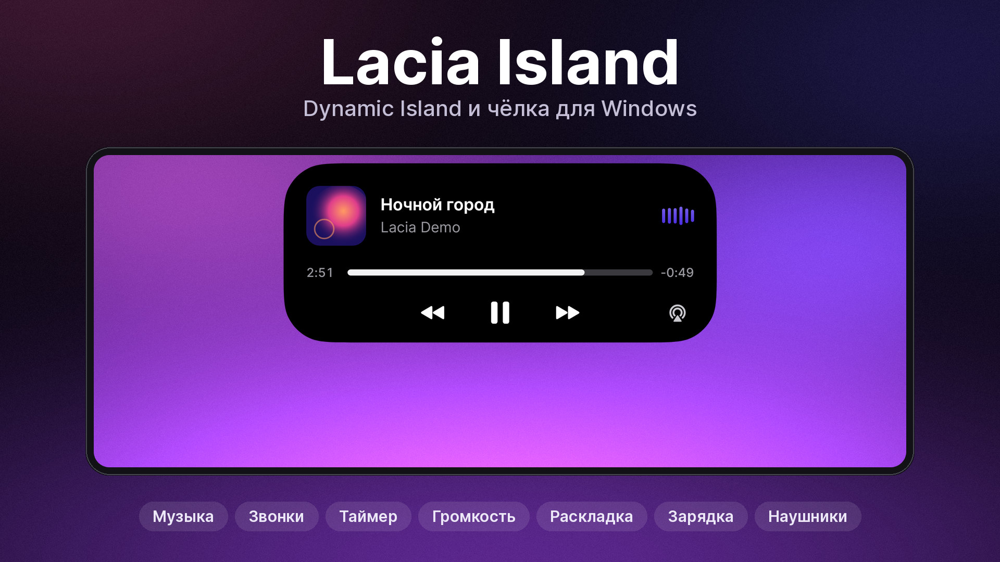
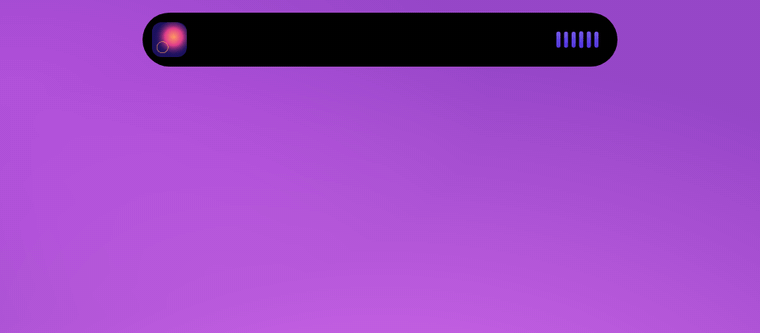
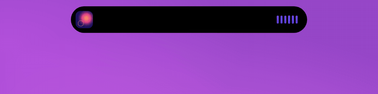
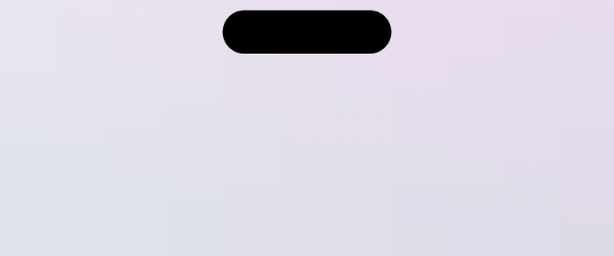
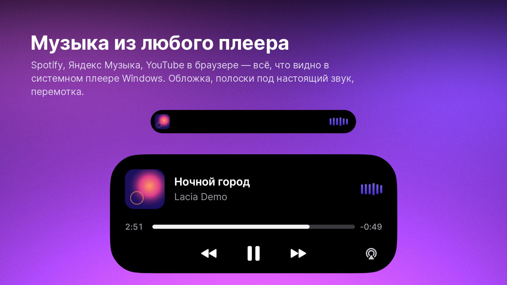
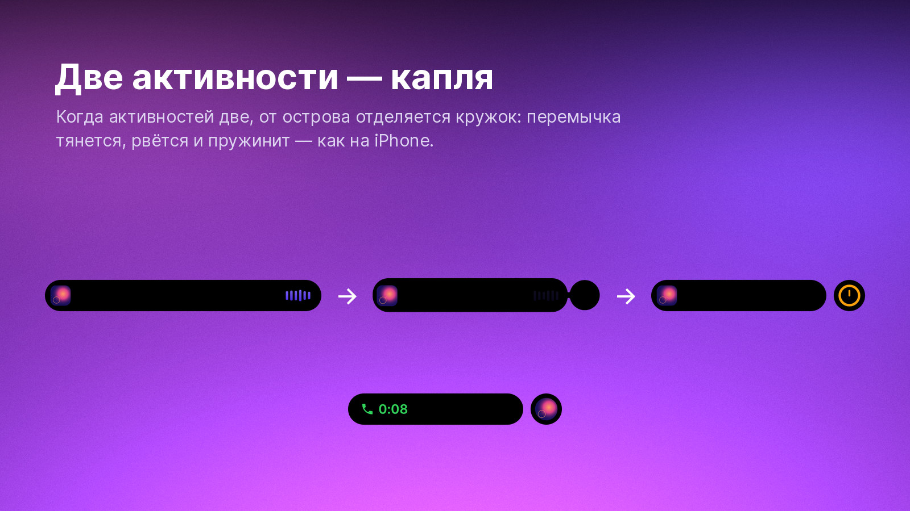
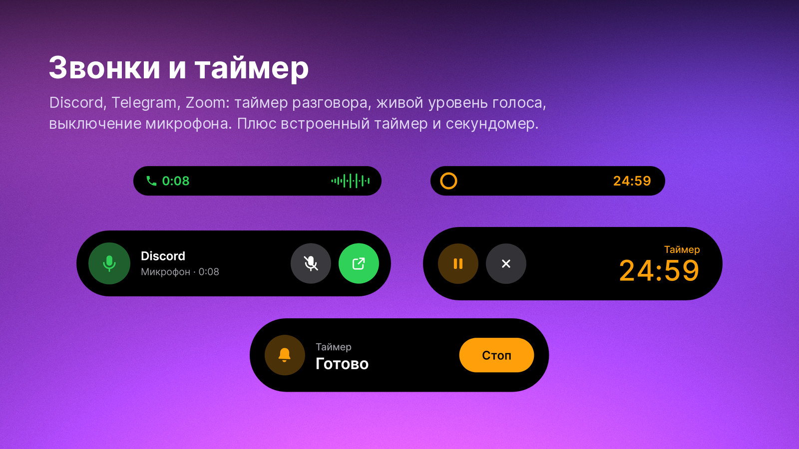
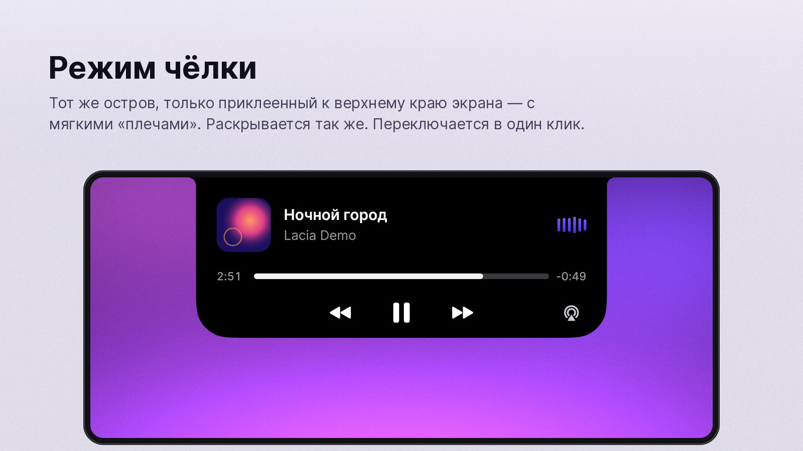
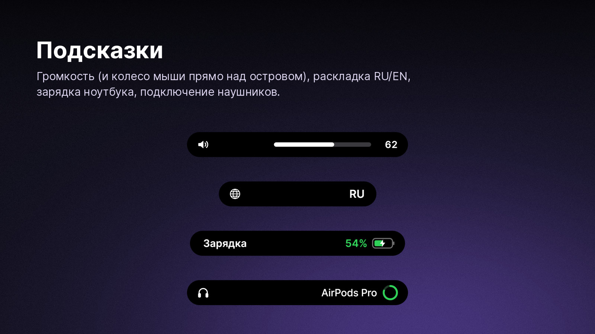
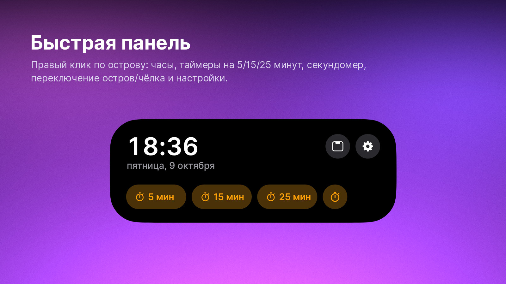

<p align="center">
  
</p>

<h1 align="center">Lacia Island</h1>

<p align="center">
  Dynamic Island и чёлка для Windows: чёрный остров сверху экрана с живой «желейной» анимацией, как на iPhone.<br>
  Музыка, звонки, таймер, громкость, раскладка, зарядка и наушники — в одном месте.
</p>

<p align="center">
  <a href="../../releases/latest"></a>
</p>

<p align="center">
  
  
  
  
</p>

<p align="center"><b>Русский</b> · <a href="README.en.md">English</a></p>

---

## Что умеет

- **Музыка** из любого плеера, который видно в системном медиаблоке Windows: Spotify, Яндекс Музыка, Apple Music, YouTube и VK в браузере. Обложка, полоски под настоящий звук, перемотка, пауза и переключение треков. Обложка меняется вместе с треком.
- **Звонки.** Когда программа занимает микрофон (Discord, Telegram, Zoom, Teams…), остров показывает время разговора и уровень голоса. Микрофон можно выключить прямо с острова, а кнопка справа открывает само приложение.
- **Таймер и секундомер** — из быстрой панели или меню в трее; пауза и отмена — прямо на острове. Когда время вышло, остров звенит и показывает «Готово».
- **Две активности сразу.** Если играет музыка и идёт таймер, от острова отделяется кружок: перемычка тянется, рвётся и пружинит, как на iPhone. Свайп меняет активности местами, клик по кружку раскрывает его. В режиме чёлки вторая активность показывается значком справа внутри чёлки.
- **Подсказки:** громкость (её можно крутить колесом мыши прямо над островом), раскладка RU/EN, зарядка ноутбука и низкий заряд, подключение наушников и их заряд.
- **Режим чёлки (Notch).** Остров прилипает к верхнему краю экрана с мягкими «плечами». Переключается в один клик.
- **Размер и длина** меняются на лету: ползунками в настройках, а длина ещё и через Ctrl + колесо мыши.
- **Не мешает работать:** клики мимо острова проходят в окна под ним, в полноэкранных играх и видео он прячется. Есть автозапуск и выбор монитора.

## В движении

<p align="center"></p>
<p align="center"><sub>Клик — плеер раскрывается и сворачивается обратно</sub></p>

<p align="center"></p>
<p align="center"><sub>Запустили таймер — от острова «отекает» кружок</sub></p>

<p align="center"></p>
<p align="center"><sub>Звонок: время, уровень голоса, выключение микрофона</sub></p>

<p align="center"></p>
<p align="center"><sub>Режим чёлки</sub></p>

<p align="center"></p>
<p align="center"><sub>Ctrl + колесо мыши — длина острова</sub></p>

<p align="center"></p>
<p align="center"><sub>Громкость, раскладка, зарядка, наушники</sub></p>

## Галерея

<table>
  <tr>
    <td></td>
    <td></td>
  </tr>
  <tr>
    <td></td>
    <td></td>
  </tr>
  <tr>
    <td></td>
    <td></td>
  </tr>
</table>

## Установка

1. Скачайте `LaciaIsland.exe` со страницы [Releases](../../releases/latest).
2. Запустите его. Устанавливать ничего не нужно, .NET тоже: всё внутри одного файла.
3. Windows может показать окно «Система Windows защитила ваш компьютер» — у программы нет платной цифровой подписи. Нажмите **Подробнее → Выполнить в любом случае**.
4. Чтобы остров запускался сам, включите в настройках **«Запускать вместе с Windows»**.

Нужна Windows 10 (версия 2004 или новее) или Windows 11, 64-бит.

**Обновление:** правый клик по значку в трее → «Выход», замените exe на новый и запустите.

**Удаление:** выключите автозапуск в настройках, выйдите через трей и удалите exe и папки `%APPDATA%\LaciaIsland` и `%TEMP%\.net\LaciaIsland`.

## Управление

| Действие | Что происходит |
|---|---|
| Клик по острову | раскрыть или свернуть (плеер, звонок, таймер); если активностей нет — быстрая панель |
| Правый клик | быстрая панель: часы, таймеры, секундомер, остров ↔ чёлка, настройки |
| Средняя кнопка мыши | пауза / воспроизведение |
| Колесо мыши над островом | громкость |
| Ctrl + колесо мыши | длина острова |
| Свайп влево или вправо | поменять местами две активности |
| Клик по кружку рядом с островом | раскрыть вторую активность |
| Клик по обложке в раскрытом плеере | перейти в сам плеер (Spotify, браузер…) |
| Кнопка справа внизу плеера | настройки звука Windows |
| Перетащить полосу прогресса | перемотка |
| Значок в трее | клик — настройки, правый клик — режим, таймер, выход |

## Настройки

Открываются кликом по значку в трее или шестерёнкой в быстрой панели. Сохраняются сразу.

- **Вид:** остров или чёлка, размер, длина, отступ сверху, монитор.
- **Поведение:** раскрывать при наведении, прятать, когда ничего не происходит (показать — подвести мышь к верхнему краю экрана, туда, где остров), прятать в полноэкранных приложениях, запускать вместе с Windows.
- **Активности:** что показывать (музыка, живой визуализатор, звонки, громкость, раскладка, зарядка, наушники, звук таймера), какие программы не считать звонком, быстрые таймеры.

Настройки и лог лежат в `%APPDATA%\LaciaIsland\` (`settings.json`, `log.txt`), в настройках есть кнопка «Папка с логами».

## Частые вопросы

**Не видно музыку.** Остров берёт треки из системного медиаблока Windows — того, что появляется рядом с громкостью. Если плеера там нет, Lacia Island его тоже не увидит. Браузеры (Chrome, Edge, Firefox, Яндекс Браузер) передают туда музыку и видео сами.

**Показывает звонок, хотя я не звоню.** Какая-то программа держит микрофон открытым. NVIDIA Broadcast, Voicemeeter и Krisp уже в исключениях; другую впишите в настройках в поле «Не считать звонком» — так, как её называет остров, или имя её exe.

**Колесо мыши не меняет громкость.** Курсор должен быть прямо над островом, а в Windows должна быть включена настройка «Прокручивать неактивные окна при наведении» (по умолчанию она включена).

**Ругается антивирус или SmartScreen.** Exe не подписан. Если не хотите ему доверять, соберите программу сами — это одна команда, она ниже.

**Анимация дёргается.** Выйдите из острова через трей и запустите `LaciaIsland.exe --diag`. Пока идёт анимация, каждые 5 секунд в `log.txt` пишется строка с fps и временем кадра. Приложите её к issue.

### Параметры запуска

Если остров уже запущен, сначала выйдите из него через трей: второй экземпляр сразу закрывается (кроме запуска с `--multi`).

| Параметр | Зачем |
|---|---|
| `--demo` | прокрутить демо-сценарий на выдуманных данных |
| `--diag` | писать в лог fps и задержки анимаций |
| `--avalonia-window` | запасной способ отрисовки: обычное окно Avalonia (клики сквозь него не проходят) |
| `--multi` | разрешить второй экземпляр |

## Как это устроено

- Остров рисуется кодом, кадр за кадром, в маленькое прозрачное окно (`UpdateLayeredWindow`). Окно не забирает фокус, а клики мимо острова уходят в окна под ним. Кадры идут по своему таймеру с частотой монитора (до 144 Гц) и не зависят от системного композитора, поэтому анимации стартуют сразу, без подвисаний.
- «Желе» — это физика пружин, как `spring` в SwiftUI: ширина, высота и скругление — отдельные пружины, а сжатие и растяжение считаются из их скоростей.
- Форма — «сквиркл» с плавными углами. Кружок второй активности соединён с островом метабол-перемычкой, которая тянется и рвётся.
- Музыка — системный медиаблок Windows (Global System Media Transport Controls). Громкость, устройства, микрофон и полоски визуализатора — Core Audio через NAudio (захват звука WASAPI loopback + FFT).
- Звонки — по данным Windows о том, какая программа сейчас использует микрофон. По этим же данным Windows показывает значок микрофона в трее.
- Окно настроек и трей — Avalonia UI.

## Сборка из исходников

Нужен [.NET 10 SDK](https://dotnet.microsoft.com/download/dotnet/10.0). Скачайте исходники (кнопка **Code → Download ZIP**) или склонируйте репозиторий и в его папке запустите:

```
build.cmd
```

Готовый `LaciaIsland.exe` появится в папке `publish`. На Linux то же самое делает `bash build.sh`.

Запустить без сборки exe (Windows):

```
dotnet run --project src/LaciaIsland -f net10.0-windows10.0.19041.0
```

На Linux можно посмотреть демо без системных функций: `dotnet run --project src/LaciaIsland -f net10.0`.

### Что где лежит

```
src/LaciaIsland/
  Core/               пружины, форма острова, метаболы
  Model/              настройки и модели данных
  UI/                 контроллер, отрисовка, экраны (музыка, звонок, таймер, подсказки, панель), окно настроек
  Services/           интерфейсы, таймер, спектр, демо-данные
  Platform/Windows/   медиаблок, Core Audio, микрофон и камера, питание, раскладка, прозрачное окно
tools/FrameRenderer/  рендер кадров без экрана — им сделаны GIF и картинки в docs/
tools/icons/          генератор иконок
```

## Лицензия

[MIT](LICENSE). Сторонние библиотеки и шрифт — в [THIRD-PARTY-NOTICES.md](THIRD-PARTY-NOTICES.md).

Lacia Island — независимый проект и не связан с Apple. Dynamic Island и iPhone — товарные знаки Apple Inc.
